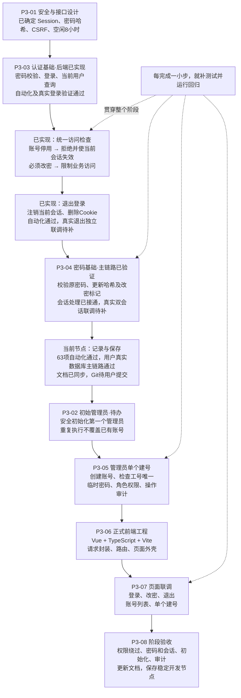
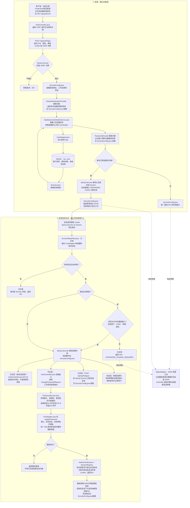

# P3 开发流程与登录业务链路

更新日期：2026-10-25

本笔记用于理解 P3 的开发顺序和运行链路，不替代需求规格与验收标准。

进度说明：登录、退出、统一状态检查、改密及会话登记已实现。2026-10-25助手实际运行63项自动化测试全部通过（含28项HTTP测试）。用户已完成真实数据库的登录→改密→当前会话失效→旧密码拒绝→新密码登录→解除改密限制→业务访问。真实双会话失效、超时清理和正式前端仍未验证。“待办”不代表已有功能。

## 一、P3 开发流程

编号沿用开发计划。实际先推进认证基础，初始管理员稍后补齐，不必严格按编号执行。测试贯穿开发过程，不只在阶段末尾进行。

P3 的终点：真实账号能够通过正式页面登录并按身份访问；管理员能够创建账号。工单提交、分派和处理属于后续阶段。

## 二、P3 功能的基础业务链路

框架节点表示由 Spring Security 提供实现，我们通过配置使用，不自己重写。图中主要展示正常请求顺序；未通过 CSRF 检查的请求会提前被拒绝，不一定进入后面的账号检查。

补充边界：

- 登录由 Spring Security 处理，不需要在 `AuthController` 再写一个登录方法。
- `SecurityConfig` 配置规则，框架过滤器执行规则；它不是所有请求都要调用的 Controller。
- 统一状态检查已在安全过滤器链接入；`/me` 也保留账号状态检查。角色管理接口授权仍待后续实现。
- 退出和登录处理过滤器有各自的执行位置，图中按功能归组，并非完整的框架过滤器顺序图。
- 改密文件已落地，具体职责见下表；管理员建号及审计仍待办。
- 会话失效不追溯中止已执行中的并发请求；改密与新登录交错的竞态未验收，不把顺序请求测试当作所有并发场景证明。

## 三、文件职责对照

后端 Java 包根目录：`E:/工单系统/backend/src/main/java/com/github/luoyubyte/backend/`。

| 文件 | 主要职责 |
| --- | --- |
| [SecurityConfig.java](E:/工单系统/backend/src/main/java/com/github/luoyubyte/backend/config/SecurityConfig.java) | 配置安全规则，组装登录、密码校验和过滤器链 |
| [DatabaseUserDetailsService.java](E:/工单系统/backend/src/main/java/com/github/luoyubyte/backend/security/DatabaseUserDetailsService.java) | 将数据库账号转换为框架的登录用户 |
| [UserMapper.java](E:/工单系统/backend/src/main/java/com/github/luoyubyte/backend/mapper/UserMapper.java) | 定义查询与密码条件更新 SQL，交给 MyBatis 执行 |
| [SysUser.java](E:/工单系统/backend/src/main/java/com/github/luoyubyte/backend/entity/SysUser.java) | 承接数据库用户字段 |
| [AccountStateFilter.java](E:/工单系统/backend/src/main/java/com/github/luoyubyte/backend/security/AccountStateFilter.java) | 统一检查最新账号状态和强制改密限制，已接入 |
| [AuthController.java](E:/工单系统/backend/src/main/java/com/github/luoyubyte/backend/controller/AuthController.java) | 提供 CSRF、当前用户、改密接口；改密成功后处理会话 |
| [ChangePasswordRequest.java](E:/工单系统/backend/src/main/java/com/github/luoyubyte/backend/dto/ChangePasswordRequest.java) | 接收原密码/新密码，不接受目标工号，toString隐藏密码 |
| [PasswordService.java](E:/工单系统/backend/src/main/java/com/github/luoyubyte/backend/service/PasswordService.java) | 校验密码与状态、编码新密码并执行条件更新 |
| [application.properties](E:/工单系统/backend/src/main/resources/application.properties) | 数据库连接参数、密码环境变量引用及会话空闲超时配置 |
| [LoginHttpTests.java](E:/工单系统/backend/src/test/java/com/github/luoyubyte/backend/security/LoginHttpTests.java) | 模拟 HTTP 请求，验证登录、会话和接口行为 |
| [PasswordServiceTests.java](E:/工单系统/backend/src/test/java/com/github/luoyubyte/backend/service/PasswordServiceTests.java) | 验证改密输入边界、密码匹配、条件更新及失败处理 |

## 四、两个 Mapper 不要混淆

- `UserMapper`：我们定义的数据库访问接口，MyBatis 创建实现对象，执行 SQL 并把结果映射成 `SysUser`。
- `ObjectMapper`：Jackson 提供的 Java 对象与 JSON 转换工具，由 Spring Boot 配置，不负责查询数据库。

## 五、阅读与维护

流程图采用 Mermaid 格式，源代码直接保存在 Markdown 中。支持 Mermaid 的预览器可以显示为图；不支持的编辑器会显示流程图代码。复制到语雀时可使用其 Mermaid 图表功能，实际展示取决于编辑器支持。

本笔记是 2026-10-25 的进度快照。下一步按原计划先保存当前节点，再推进初始管理员、单个建号及审计、正式前端。真实双会话、超时与页面联调等待验证项保留，不把P3整体标记为完成。
